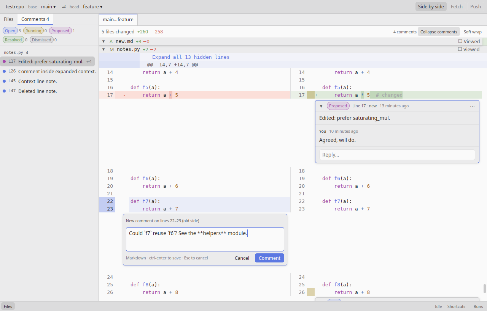
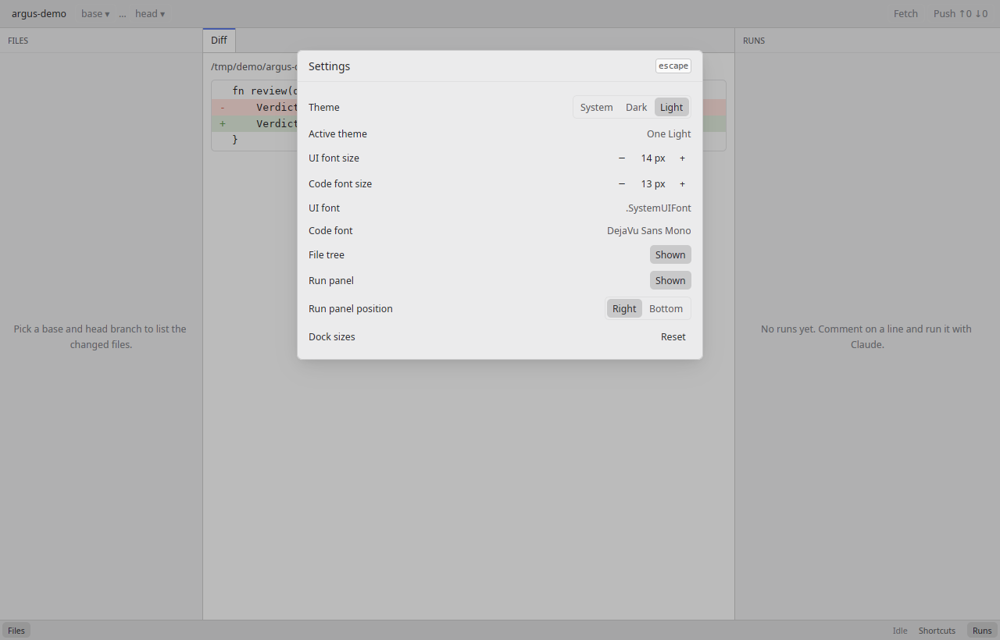
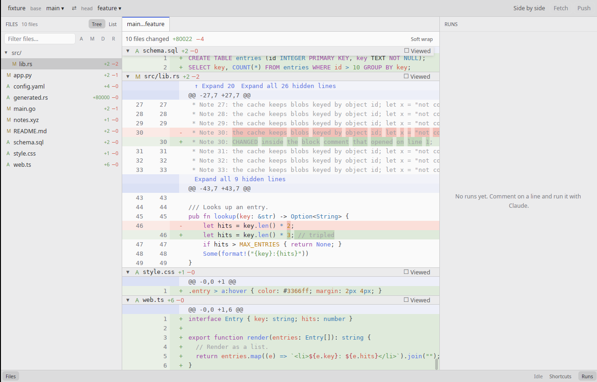
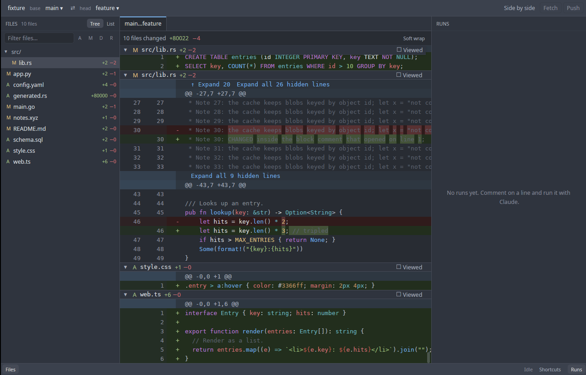
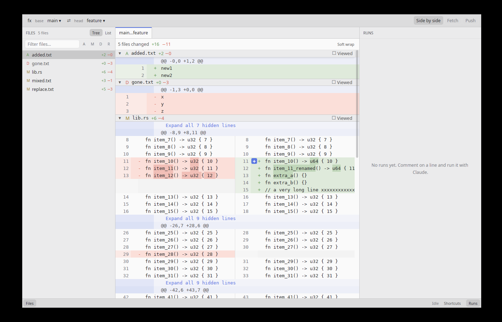
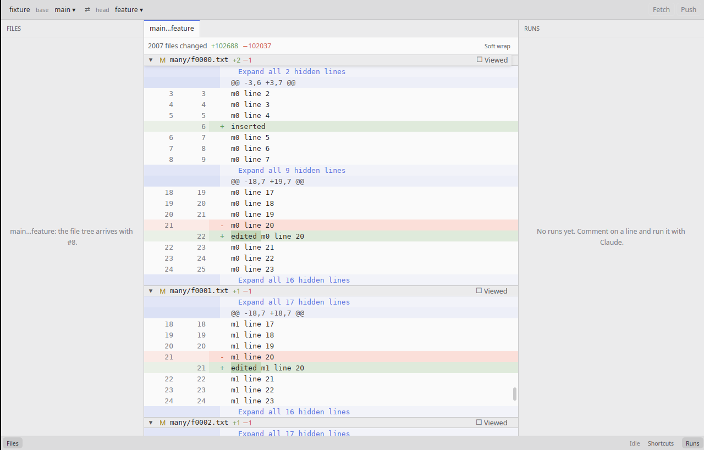
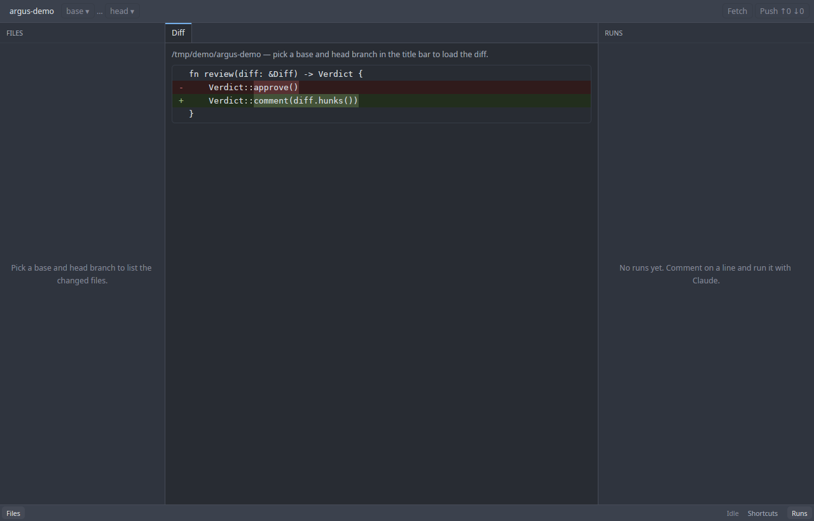
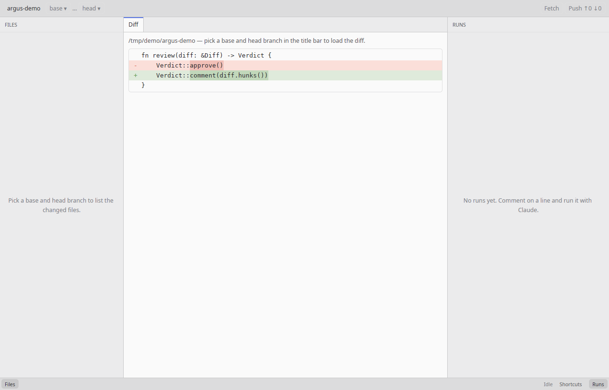

# Argus

Argus is a native desktop code-review tool written in Rust with GPUI and styled
like the Zed editor. You pick a base and a head branch, read the diff, comment on
lines, and have Claude Code apply each comment as a code change you can accept or
reject — with each run isolated in its own git worktree and nothing landing on the
branch until you accept it.

The full product specification lives in
[issue #1 — SPEC: Argus MVP](https://github.com/Chris-Kode/argus/issues/1).
Feature work is tracked as sub-issues of that spec.

## Quick start

```sh
# rustup installs the pinned toolchain from rust-toolchain.toml automatically
cargo run -p argus
```

This opens the Argus shell: open a repository (`cmd-o` / `ctrl-o`) or pick one
from the recent list. `cmd-/` (`ctrl-/` on Linux) lists every keyboard shortcut,
and `cmd-,` opens the settings. User data lives in `~/.argus/`; set
`ARGUS_HOME` to override it (used by tests and CI):

```sh
ARGUS_HOME=/tmp/argus-dev cargo run -p argus
```

Once base and head are picked, the center shows the three-dot diff: every changed
file in one virtualized list, laid out lazily as it scrolls into view. `j`/`k`
jump between files, `n`/`p` between hunks, and `alt-z` toggles soft wrap. Click
or drag the gutter to select lines, and use the "Expand" rows to reveal context.

The diff opens side by side by default: old lines on the left, new lines on the
right, each column with its own gutter (the left one selects old lines, the
right one new lines). `cmd-shift-d` (`ctrl-shift-d` on Linux) or the "Side by
side" title-bar button switches to the unified layout and back, keeping the
line at the top of the viewport in place. The settings choose the default
layout and whether both columns scroll horizontally together.

Comment on any line, or a range, on either side: hover a line and click the
gutter "+", or select lines (click, shift-click or drag the gutter) and press
`c`. Removed lines are commented on the old side; added and context lines on the
new side (in side-by-side mode, the column you pick decides). A range cannot
cross a hunk header. The composer opens under the last line: write Markdown,
save with `cmd-enter` (`ctrl-enter` on Linux), cancel with `esc`; unsaved
drafts are kept while Argus runs. Threads show inline under their lines with a
status chip (Open, Running, Proposed, Resolved, Dismissed), replies and a menu
to edit, delete, dismiss or reopen. `]c` / `[c` jump between threads, `shift-c`
folds them all, and the "Comments" tab of the left dock (`cmd-shift-c`) lists
every thread by file, filterable by status. File-tree rows show a comment
count. Debug builds add "Advance status (debug)" to the thread menu, to try
the status chips before runs exist.



The settings sheet (`cmd-,`) groups the Claude run defaults, the diff options,
the appearance and the dock layout, each section with a "Reset to defaults"
button. The Claude section covers:

- the `claude` binary (empty means auto-detect on `PATH`);
- the default model and effort, and the lists the Run menu offers;
- the review rules file;
- the commit-message timeout.

Text fields apply on Enter. An invalid value, such as a Claude path that does
not exist or is not executable, shows an inline error and is not saved. Valid
changes apply to the next run without a restart. On first launch Argus writes
default rules to `~/.argus/review-rules.md`. It never overwrites that file, and
every run appends it to Claude's system prompt. "Open in editor" opens it with
the system's default application.



Code is syntax-highlighted with tree-sitter, Zed-style, for Rust,
TypeScript/TSX, JavaScript/JSX, Python, Go, Java, Kotlin, Swift, C, C++, C#,
Ruby, PHP, JSON, YAML, TOML, Markdown, HTML, CSS, SQL and Bash (detected from the
file name, extension or shebang; anything else stays plain text). Highlighting
runs on background threads and parses each whole file once, so a block comment
that opens above a hunk is still colored inside it; text is shown plain right
away and recolored when the highlights arrive. Files over 2 MB or 50,000 lines
stay plain unless you click "Highlight" in their header.








## Development

See [CONTRIBUTING.md](CONTRIBUTING.md) for build, lint and GPUI-pin conventions,
and [AGENTS.md](AGENTS.md) for the rules that apply to AI coding agents.

## License

Apache-2.0. See [LICENSE](LICENSE).
