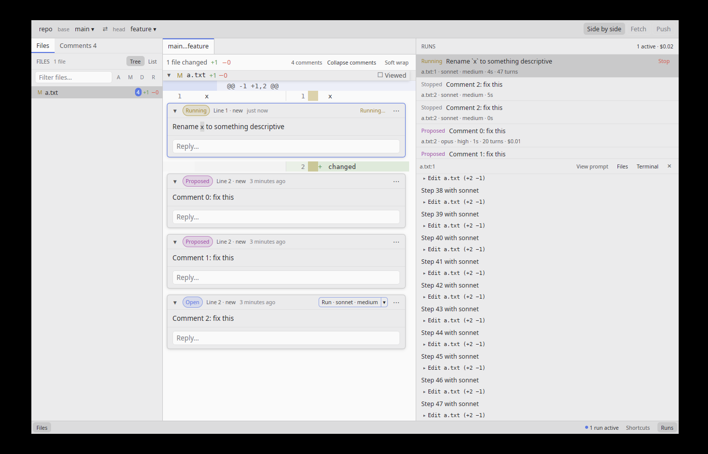
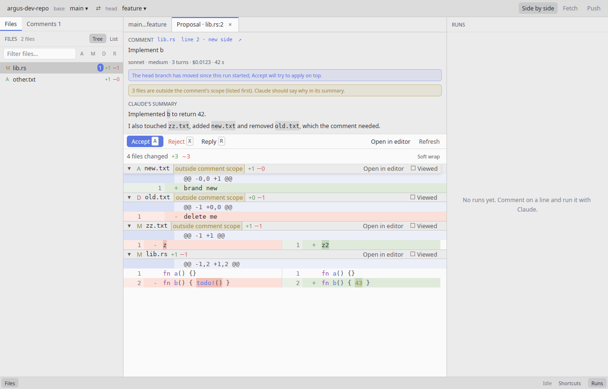

# Argus

Argus is a native desktop code-review tool written in Rust with GPUI and styled
like the Zed editor. You pick a base and a head branch, read the diff, comment on
lines, and have Claude Code apply each comment as a code change you can accept or
reject — with each run isolated in its own git worktree and nothing landing on the
branch until you accept it.

The full product specification lives in
[issue #1 — SPEC: Argus MVP](https://github.com/Chris-Kode/argus/issues/1).
Feature work is tracked as sub-issues of that spec.


## Requirements

- **macOS 11 or later** (Apple silicon or Intel). Linux builds are best effort.
- **git 2.40 or later.** The Xcode Command Line Tools (`xcode-select --install`)
  or Homebrew (`brew install git`) both work; check with `git --version`.
- **Claude Code**, installed and signed in: install it from
  [claude.com/claude-code](https://claude.com/claude-code), then run `claude` once
  in a terminal and log in. Argus finds `claude` on your `PATH` or in the usual
  install locations (`~/.local/bin`, `~/.claude/local`, Homebrew, npm, Bun,
  Volta); set its path in the settings if it lives elsewhere. Argus stores no
  API keys: runs use Claude Code's own login.
- To build from source: [rustup](https://rustup.rs). The pinned toolchain in
  `rust-toolchain.toml` installs itself on the first build.

## Install

### macOS

Build the app bundle (a release build takes a few minutes):

```sh
git clone https://github.com/Chris-Kode/argus.git
cd argus
cargo xtask bundle
```

This writes to `target/bundle/`:

- `Argus.app`;
- `Argus-<version>-macos-<arch>.dmg`: open it and drag Argus to Applications;
- `Argus-<version>-macos-<arch>.zip`: the same app, zipped.

`cargo xtask bundle --universal` builds one app for both Apple silicon and Intel
(first `rustup target add aarch64-apple-darwin x86_64-apple-darwin`).

#### Signing and Gatekeeper

By default the app is signed ad hoc, not with a Developer ID, and it is not
notarized. On the Mac that built it, it opens normally. On another Mac, the
first launch is blocked by Gatekeeper ("Apple could not verify…"): open
**System Settings → Privacy & Security** and click **Open Anyway** next to the
Argus message, or clear the download quarantine once:

```sh
xattr -dr com.apple.quarantine /Applications/Argus.app
```

To hand the app to other people, sign it with a Developer ID and notarize it
(this needs an Apple Developer Program membership):

1. Install a **Developer ID Application** certificate in your login keychain
   and find its name with `security find-identity -v -p codesigning`.
2. Store notary credentials in the keychain once, under a profile name of your
   choice (an [app-specific password](https://support.apple.com/102654) works):

   ```sh
   xcrun notarytool store-credentials argus-notary --apple-id you@example.com --team-id TEAMID
   ```

3. Bundle with both:

   ```sh
   cargo xtask bundle --sign "Developer ID Application: Your Name (TEAMID)" --notarize argus-notary
   ```

`--sign` signs the app (hardened runtime, secure timestamp) and the `.dmg`.
`--notarize` sends the `.dmg` to Apple, waits for the verdict (usually a few
minutes) and staples the ticket to the `.dmg` and the app, so the `.zip` made
afterwards carries it too. Gatekeeper then opens Argus without any prompt,
even offline. `--sign` alone gives a Developer-ID-signed app that Gatekeeper
still blocks until it is notarized. `ARGUS_SIGN_IDENTITY` and
`ARGUS_NOTARY_PROFILE` can stand in for the two flags, e.g. in CI.

### Linux (best effort)

`cargo xtask bundle` on Linux writes `target/bundle/argus-<version>-linux-<arch>.tar.gz`
with the `argus` binary, an `argus.desktop` entry and an `argus.png` icon. Put
the binary on your `PATH`, and the desktop entry and the icon in
`~/.local/share/applications` and `~/.local/share/icons`. GPUI needs the usual
Vulkan, Wayland or X11 and font libraries.

## Two-minute walkthrough

The whole loop: comment on a line, let Claude change the code, accept the change,
push it.

1. **Open a repository.** Launch Argus and press `⌘O` (or pick one from the
   recent list). Argus never touches your uncommitted changes. When it commits
   to a branch you have checked out, it updates only the files that commit
   changes in your checkout, like `git checkout` would.
2. **Pick the branches.** Choose the base (e.g. `main`) and the head (the branch
   under review) in the title bar. The center shows the three-dot diff
   `base...head`; `j`/`k` move between files and `n`/`p` between hunks.
3. **Comment.** Hover a line and click the gutter **+** (or select lines in the
   gutter and press `c`). Write what you want changed, in Markdown, and save with
   `⌘↩`.
4. **Run it with Claude.** Click **Run · sonnet · medium** on the thread (or press
   `r`). Claude Code runs headless in its own worktree under `~/.argus/worktrees/`;
   follow it live in the run panel (`⌘J`). Runs go in parallel, so you can keep
   commenting.

   

5. **Review the proposal.** When the run finishes, the comment turns *Proposed*.
   Click **View proposal**: the tab shows only what Claude changed, with its
   summary. Not quite right? Reply to send a follow-up run in the same session.
   Press `x` twice to reject it instead; its worktree is deleted.

   

6. **Accept.** Press `a` (or click **Accept**). Claude Haiku drafts the commit
   body; edit the message and click **Commit**. The change becomes one local commit on
   the head branch, the comment turns *Resolved* and the diff refreshes. If the
   head branch moved and the change no longer applies, a conflict dialog lets you
   resolve it by hand or with Claude.
7. **Push.** The title bar's **Push ↑1 ↓0** button sends the head branch to its
   upstream, pulling with rebase first when the remote is ahead. Argus never
   pushes on its own and never force-pushes.

## Keyboard shortcuts

`⌘/` lists every shortcut in the app. On Linux, `⌘` is `ctrl`. Single-key
shortcuts work whenever the focus is not in a text field.

| Keys | Action |
| --- | --- |
| `⌘O` | Open a repository |
| `⌘,` | Settings |
| `⌘/` | Keyboard shortcuts |
| `j` / `k` | Next / previous file |
| `n` / `p` | Next / previous hunk |
| `/` | Filter the files |
| `c` | Comment on the selected line(s) |
| `⌘↩` / `esc` | Save / cancel the comment |
| `]c` / `[c` | Next / previous comment |
| `⇧C` | Collapse / expand all comments |
| `r` | Run the comment with Claude (in a proposal: reply) |
| `a` | Accept the proposal |
| `x` | Reject the proposal (press again to confirm) |
| `⌘B` | Toggle the file tree |
| `⌘⇧C` | Show the files / the comment list |
| `⌘⇧L` | Toggle tree / flat file list |
| `⌘J` | Toggle the run panel |
| `⌘⇧J` | Dock the run panel right / bottom |
| `⌘⇧D` | Toggle unified / side-by-side diff |
| `⌥Z` | Toggle soft wrap |
| `⌘K ⌘T` | Cycle theme (system, dark, light) |
| `⌘=` / `⌘-` / `⌘0` | Larger / smaller / reset font size |
| `⌘Q` | Quit |

## Where data lives

Everything Argus writes lives in `~/.argus/`, never inside a reviewed repository:

| Path | What |
| --- | --- |
| `~/.argus/argus.db` | SQLite database: repositories, comments, runs, accepts, settings |
| `~/.argus/review-rules.md` | Rules appended to every run's system prompt; edit freely, never overwritten |
| `~/.argus/worktrees/` | One git worktree per run, plus each repository's `_integration` worktree for Accept and Push |
| `~/.argus/logs/argus.log` | Log file |

Set `ARGUS_HOME` to use another directory, e.g. `ARGUS_HOME=/tmp/argus-dev`.
Deleting `~/.argus` resets Argus; your repositories are not affected, though
`git worktree prune` in each one cleans up the worktree entries left behind.

## Safety rules

These hold for every run, Accept and Push (spec §11):

1. Claude never edits your working checkout: runs happen in worktrees under
   `~/.argus/worktrees/`.
2. Nothing is committed until you click Accept; Reject deletes the worktree.
3. Commits stay local; only Push sends them, after a pull with rebase. Argus never
   force-pushes.
4. Accepts are serialized per repository with compare-and-swap ref updates;
   conflicts open the conflict dialog and never fail silently.
5. Argus never reads or modifies uncommitted changes, and stores no API keys.

## Features in detail

Once base and head are picked, the center shows the three-dot diff: every changed
file in one virtualized list, laid out lazily as it scrolls into view. `j`/`k`
jump between files, `n`/`p` between hunks, and `alt-z` toggles soft wrap. Click
or drag the gutter to select lines, and use the "Expand" rows to reveal context.

The diff opens side by side by default: old lines on the left, new lines on the
right, each column with its own gutter (the left one selects old lines, the
right one new lines). `cmd-shift-d` (`ctrl-shift-d` on Linux) or the "Side by
side" title-bar button switches to the unified layout and back, keeping the
line at the top of the viewport in place. The settings choose the default
layout and whether both columns scroll horizontally together.

Comment on any line, or a range, on either side: hover a line and click the
gutter "+", or select lines (click, shift-click or drag the gutter) and press
`c`. Removed lines are commented on the old side; added and context lines on the
new side (in side-by-side mode, the column you pick decides). A range cannot
cross a hunk header. The composer opens under the last line: write Markdown,
save with `cmd-enter` (`ctrl-enter` on Linux), cancel with `esc`; unsaved
drafts are kept while Argus runs. Threads show inline under their lines with a
status chip (Open, Running, Proposed, Resolved, Dismissed), replies and a menu
to edit, delete, dismiss or reopen. `]c` / `[c` jump between threads, `shift-c`
folds them all, and the "Comments" tab of the left dock (`cmd-shift-c`) lists
every thread by file, filterable by status. File-tree rows show a comment
count. Closed threads (Resolved after Accept, or Dismissed) leave the diff
and the Comments tab, so both show only what still needs you: the toolbar's
**Show closed** puts them back inline, and the Resolved and Dismissed chips
list them again. Debug builds add "Advance status (debug)" to the thread menu, to walk
the status chips by hand.

Comments follow their code. Every time the diff is refreshed (branch change,
Fetch, Accept), each comment looks for its lines and their context in the new
diff: unchanged, moved (lines inserted above, or the file renamed), or gone.
When the code is gone, the comment becomes **outdated**. Outdated comments are
not shown inline. They are listed in the "Outdated" group of the file tree and
the Comments tab, which shows the original code at its original line numbers.
From there, **Re-attach…** lets you pick new lines in the diff (gutter "+",
`c` on a selection, or Save in the bar), and **Dismiss** closes the comment.
Outdated comments cannot be run. A comment that finds its code again (for
example after a revert) is no longer outdated. Resolved comments are moved
too, but are never flagged outdated.

Run a comment with Claude from its thread: the "Run · sonnet · medium ▾"
split button runs with the shown model and effort, and its arrow opens the Run
menu with every model and effort on offer. `r` runs the focused
thread. The last choice becomes the default for the next run and survives a
restart. Run is disabled for outdated comments and while Claude Code is
missing or too old. Each run gets its own worktree, and runs go in parallel.

A run has everything a normal Claude Code session has: every tool, your
settings and `CLAUDE.md`, MCP servers, skills and plugins, and your shell
environment (minus `ANTHROPIC_*`). It works in Claude Code's `auto` permission
mode (`acceptEdits` on a CLI without it). When Claude needs you, for a tool
call the mode does not settle or a question it asks with `AskUserQuestion`,
the run waits and a dialog opens. Answer a question by picking options or
typing your own. For a tool call, choose **Allow**, **Allow for this run** or
**Deny**, with an optional note telling Claude what to do instead. **Later**
(`esc`) hides the dialog without answering; the run keeps waiting, and the
status bar's "waiting for you" counter brings the dialog back. Whatever the
mode, a run can never `git commit`, `git push`, or edit files in your own
checkout.

The run panel (`cmd-j`, docked right or bottom with `cmd-shift-j`) lists the
repository's active runs first, then the ones waiting for you: a proposal to
review, or a failure on a comment that is still open. Finished runs (accepted,
rejected, dismissed, stopped, empty, or followed by a newer run of the same
comment) fold behind the header's **Show finished**. Each row shows the comment,
`file:line`, model and effort, status, elapsed time, turns, cost and a Stop
button, and the header totals the active runs and their cost. Clicking a row
jumps to its comment and shows the run's live log: assistant text as
Markdown, tool calls as compact rows (`Edit src/foo.rs (+3 −1)`,
`Bash git diff`) that expand to their input and output, errors in red, and the
final summary. The log follows new output until you scroll up. "View prompt"
shows what Claude was sent, and "Finder"/"Files" and "Terminal" open the run's
worktree. The status bar shows how many runs are active.

When a run finishes with a change, its comment turns Proposed. "View proposal"
(on the thread, or in its menu) opens a proposal tab next to the diff tab. The
tab shows only what Claude changed: the diff from the commit the run started at
to its worktree, including new and deleted files, in the same viewer. Above the
diff are the comment (its location links back to the thread), the model, effort,
turns, cost and duration, and Claude's final summary. Files other than the
commented one are listed first and badged "outside comment scope". A banner
warns when the head branch moved after the run started. `a` accepts the
proposal, `x` rejects it (press it again to confirm), and `r` opens the reply
box. Reject deletes the run's worktree and sets the comment back to Open; the
run stays in history as Rejected. "Open in editor" opens a changed file of the
worktree in `$VISUAL` / `$EDITOR`, or with the system's default application.
The proposal refreshes as soon as the file changes on disk.

A reply on a Proposed comment, in the proposal tab or in the thread, has two
send options. **Send as follow-up run** (the default, also on Enter) starts a
follow-up: it resumes the comment's Claude session (`--resume <session>`) in
the same worktree, so Claude continues from its earlier edits. **Add note
only** just saves the reply. A follow-up uses the Run menu's model and effort.
On a Proposed thread the Run split button reads "Follow up · model · effort",
and its menu picks them. In the proposal tab, the model and effort buttons of
the reply box change the Run menu defaults. The model and effort can change
between follow-ups; the session stays the same. While the
follow-up runs, the comment is Running and the proposal's diff follows its
edits. When it finishes, the comment is Proposed again, with the combined
change of every run since the first one. Claude's final message of each run
joins the thread as a Claude reply labelled with that run's model and effort,
so the thread reads as a conversation. Once a proposal is rejected, its
worktree is gone and follow-ups are no longer offered; start a new run instead.
If Claude cannot find the session to resume, the run fails with a clear message
and a **Run fresh with the thread as context** button. That button starts a new
session whose prompt carries the comment and every reply.

The settings sheet (`cmd-,`) groups the Claude run defaults, the diff options,
the appearance and the dock layout, each section with a "Reset to defaults"
button. The Claude section covers:

- the `claude` binary (empty means auto-detect on `PATH`);
- the default model and effort, and the lists the Run menu offers;
- the review rules file;
- the commit-message timeout.

Text fields apply on Enter. An invalid value, such as a Claude path that does
not exist or is not executable, shows an inline error and is not saved. Valid
changes apply to the next run without a restart. On first launch Argus writes
default rules to `~/.argus/review-rules.md`. It never overwrites that file, and
every run appends it to Claude's system prompt. "Open in editor" opens it with
the system's default application.


Code is syntax-highlighted with tree-sitter, Zed-style, for Rust,
TypeScript/TSX, JavaScript/JSX, Python, Go, Java, Kotlin, Swift, C, C++, C#,
Ruby, PHP, JSON, YAML, TOML, Markdown, HTML, CSS, SQL and Bash (detected from the
file name, extension or shebang; anything else stays plain text). Highlighting
runs on background threads and parses each whole file once, so a block comment
that opens above a hunk is still colored inside it; text is shown plain right
away and recolored when the highlights arrive. Files over 2 MB or 50,000 lines
stay plain unless you click "Highlight" in their header.


## Development

See [CONTRIBUTING.md](CONTRIBUTING.md) for build, lint and GPUI-pin conventions,
and [AGENTS.md](AGENTS.md) for the rules that apply to AI coding agents.

```sh
# rustup installs the pinned toolchain from rust-toolchain.toml automatically
cargo run -p argus
# keep development data away from your real ~/.argus
ARGUS_HOME=/tmp/argus-dev cargo run -p argus
```

Performance: `cargo xtask fixtures` generates the large fixture repositories,
and `ARGUS_PERF=1 cargo run --release -- --repo target/fixtures/huge-files
--base base --head head --auto-scroll` prints startup and scroll timings. See
[docs/perf.md](docs/perf.md) for the harness and the latest results.

## License

Apache-2.0. See [LICENSE](LICENSE).

### Fonts

Argus bundles [IBM Plex Sans and IBM Plex Mono](https://github.com/IBM/plex)
(unmodified release files in `crates/argus_ui/assets/fonts/`) and uses them by
default; a font chosen in Settings still wins. The fonts are licensed under the
SIL Open Font License 1.1, see
[crates/argus_ui/assets/fonts/OFL.txt](crates/argus_ui/assets/fonts/OFL.txt).

### Icons

Argus bundles regular-weight icons from
[Phosphor Icons](https://github.com/phosphor-icons/core) (unmodified SVGs in
`crates/argus_ui/assets/icons/`), licensed under the MIT License, see
[crates/argus_ui/assets/icons/LICENSE](crates/argus_ui/assets/icons/LICENSE).
The Argus eye mark (`argus-eye*.svg` in the same directory) is original to
this project.
