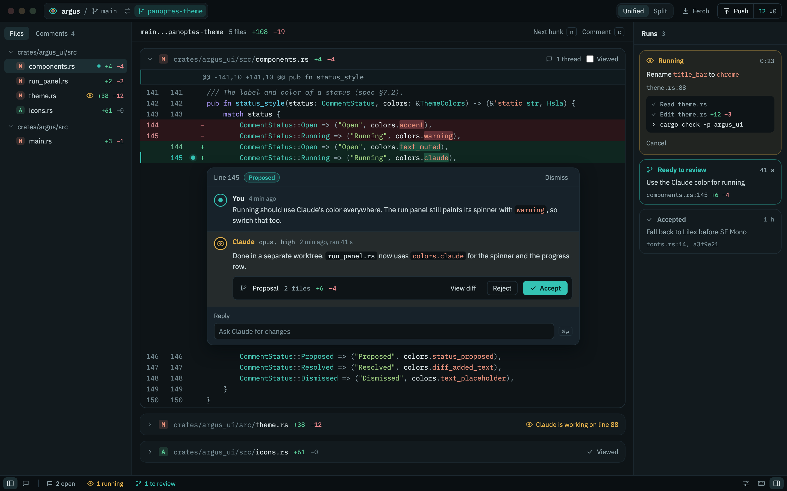
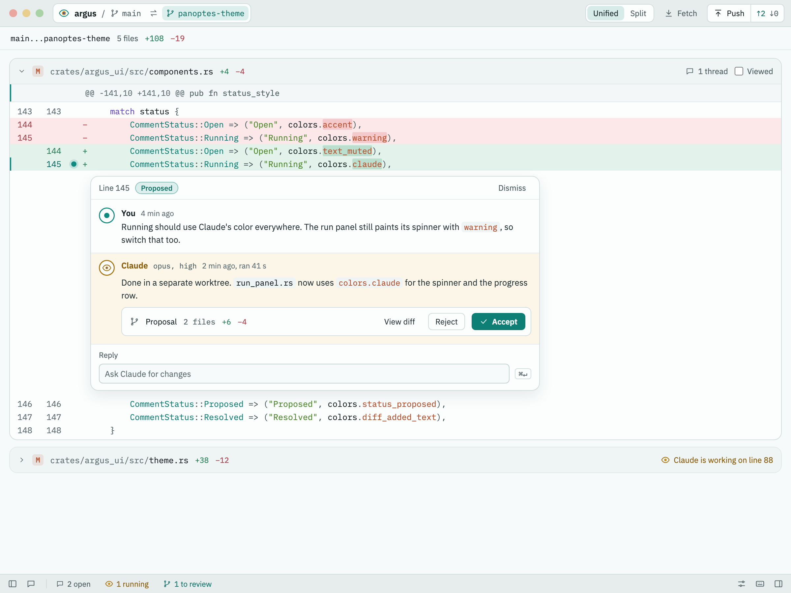
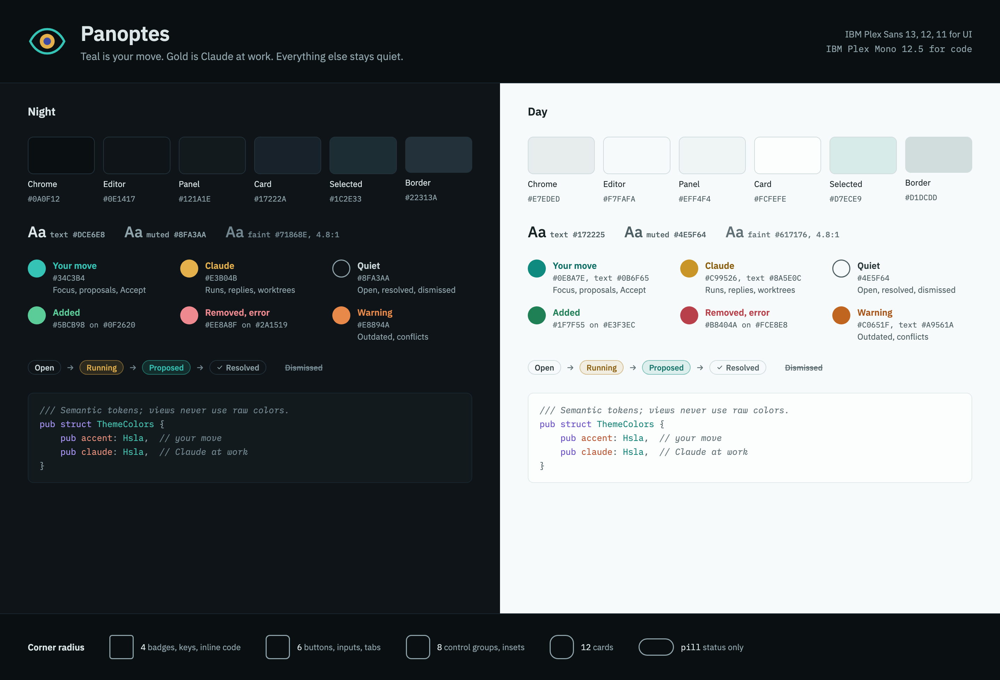

# Panoptes mockups

Static mockups of the Panoptes visual redesign. The spec, with every token value, is issue #56; where a mockup and the spec differ, the spec wins (for example, Day uses a single accent, `#0E7F74`, instead of the two teals drawn here).

| Mockup | Preview | Page |
| --- | --- | --- |
| Night review window: title bar, file tree, diff hunk, thread card, run panel, status bar | [night.png](night.png) | [night.html](night.html) |
| Day review window: title bar, diff hunk, thread card, status bar | [day.png](day.png) | [day.html](day.html) |
| Palette and tokens: surfaces, text, roles, comment lifecycle, syntax, corner radius | [palette.png](palette.png) | [palette.html](palette.html) |

The HTML pages are self-contained apart from IBM Plex, which they load from Google Fonts. Open them in a browser to inspect sizes and colors. They are design references only: the app draws everything with GPUI, not HTML.
